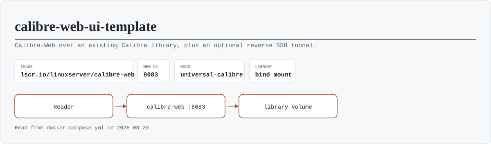
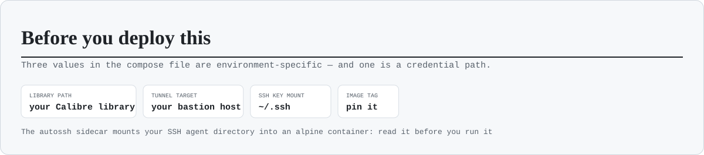

<h1 align="center">calibre-web-ui-template</h1>

<p align="center">
  <em>Calibre-Web in front of an existing Calibre library — plus an optional reverse SSH
  tunnel to reach it from outside.</em>
</p>

<p align="center">
  
</p>

<p align="center">
  
  
  
  
  
</p>

Two services in one compose file:

- **`calibre-web`** — the reading and management UI on `8083`, serving a Calibre library
  that already exists on disk. The `universal-calibre` mod adds the real Calibre binaries,
  which is what makes on-the-fly format conversion (EPUB ↔ MOBI ↔ PDF) work.
- **`calibre-autossh`** — an optional sidecar that keeps a reverse SSH tunnel open to a
  bastion host, so the UI can be reached from outside the LAN without opening a port on
  the router.

## Run it

```bash
docker compose up -d
docker logs calibre-web --tail 20                 # first boot creates the config volume
curl -sS -o /dev/null -w '%{http_code}\n' http://localhost:8083/     # expect 200
```

The first login uses the credentials the linuxserver.io image documents (`admin` /
`admin123` at the time of writing) — change them before the container is reachable by
anyone else. Point Calibre-Web at `/books` when it asks for the library location.

<p align="center">
  
</p>

## What to change before you use this

| In the compose file | Why |
|---|---|
| The library bind mount (`…:/books`) | It points at the author's library path. Yours will differ |
| The `autossh` command | It contains a specific bastion host, user and LAN address. **Delete the whole sidecar if you do not need remote access** |
| The `~/.ssh` mount | The sidecar mounts your SSH directory into an `alpine` container that installs a package at runtime. Prefer a dedicated key with a forced command, mounted read-only, over your everyday keys |
| The base tag in `calibre-web/Dockerfile` | `calibre-web` is built locally on a pinned linuxserver tag, with kepubify rebuilt on a current Go and Python packages raised past calibre-web's own pins. To update: raise the tag, `docker compose build calibre-web`, then `up -d` |
| `TZ`, `PUID`, `PGID` | Timezone, and the user that owns the library files |

## Notes

- **The library is the valuable part**, and the container mounts it read-write: Calibre-Web
  can move, convert and delete books. Back the library up independently of this stack.
- The `config` named volume holds users, shelves and settings — it is small and worth
  keeping; deleting it resets the instance, not the books.
- Exposing `8083` to the internet directly is the thing this template's tunnel exists to
  avoid. If you drop the sidecar, reach it over a VPN instead.
